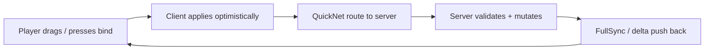

# Stoway


<div style="display:flex; flex-direction:column; gap:2px;">
<p><strong>Stoway</strong> 
is a full inventory system split into independent layers. Each layer is built in its own branch so it can be developed, tested, and maintained separately.

```
Stoway
├── master             ← integration branch
├── corestore          ← pure Luau inventory engine
├── server             ← orchestration, networking, world
└── client             ← UI rendering, drag-and-drop (this branch)
```

The layers talk to each other in one direction:

```
Client Layer → Network Layer → CoreStore ← World Layer
```

*CoreStore owns the inventory truth. Everything else reads from it or writes to it through its public API.* <br>
Download the latest packaged release from <a href="https://github.com/Zyn-ic/Stoway/releases">Releases</a>.
</p>
</div>

<br>

## This Branch: Bare-Bones Canon

`client` holds the whole playable skeleton with nothing extra: the pure-Luau
`CoreStore` engine, the `StowayServerV3_0_0` orchestration layer, and the
Fusion `StowayClientV3` UI. Example branches (`example/*`) fork this to demo
one idea each; canon stays minimal and they are never merged back.

What's in the skeleton:

- **CoreStore** (`ReplicatedStorage/Shared/Stoway/CoreStore/`) — pure Luau,
  no Roblox types. Items, hotbar/storage slots, stacking, sorting, weight,
  metadata index. Every op returns a `Result`.
- **Server** (`src/server/Services/StowayServerV3_0_0/`) — per-player states,
  13 operation routes behind a lock, QuickNet replication (sparse
  `SettingsChanged` + `FullSync` backstop), Tool spawning/equipping, and a
  Conch debug console (Studio only).
- **Client** (`src/client/StowayClientV3/`) — Fusion 0.3 UI booted from the
  server snapshot: settings-driven hotbar + sectioned storage, drag + drop
  with sweep paint-to-move, per-team tint, multi-platform input. Two layout
  engines (`StandardHotbarStorage`, `JailbreakHotbar`) share helpers in
  `Layouts/Shared`; skins are thin prefab loaders.



## Development

Type checking is the gate, run from the repo root:

```
luau-lsp analyze --definitions="globalTypes.d.luau" --sourcemap="sourcemap.json" --ignore="**/Packages/**" src
```

Expected: **0 errors**. Full contributor guide: [Contributing](https://zyn-ic.github.io/Stoway/contributing/).

## Try It

Play solo, open the Conch console (Backquote), and poke the inventory:

- `inv` — dump your current inventory
- `add sword 2` / `addhot Pickaxe 1 3` / `remove / swap / move / split / equip`
- `set-layout StandardHotbarStorage` / `set-skin Default` / `set-team cop`
- `toggle-stack` / `set-max-stack 10` / `help` — full command list

Agent notes live in `AGENTS.md` (module map, settings, invariants, pitfalls).

## Credits

1. [**HowToRoblox**](https://www.youtube.com/watch?v=kqa4u_9mSTQ&list=WL&index=6) - sourced core backpack/hotbar mechanics from earlier versions.
2. [**Knineteen19**](https://www.youtube.com/watch?v=d2tdaRmqGXI&list=WL&index=8) - series on inventory/hotbar, persistence, and stacking.
3. [**Avafe**](https://devforum.roblox.com/t/neohotbar-a-modern-customizable-backpack/2738850) - learned about Fusion and reactive UI patterns.
4. [**Illusion**](https://devforum.roblox.com/t/illusions-inputactionsystem-currently-the-best-input-manager/4071242) - InputActionSystem module.
5. [**breadboardengineer1234**](https://github.com/breadboardengineer1234/QuickNet) - QuickNet, the drop-in networking library behind Stoway's client/server wire.
