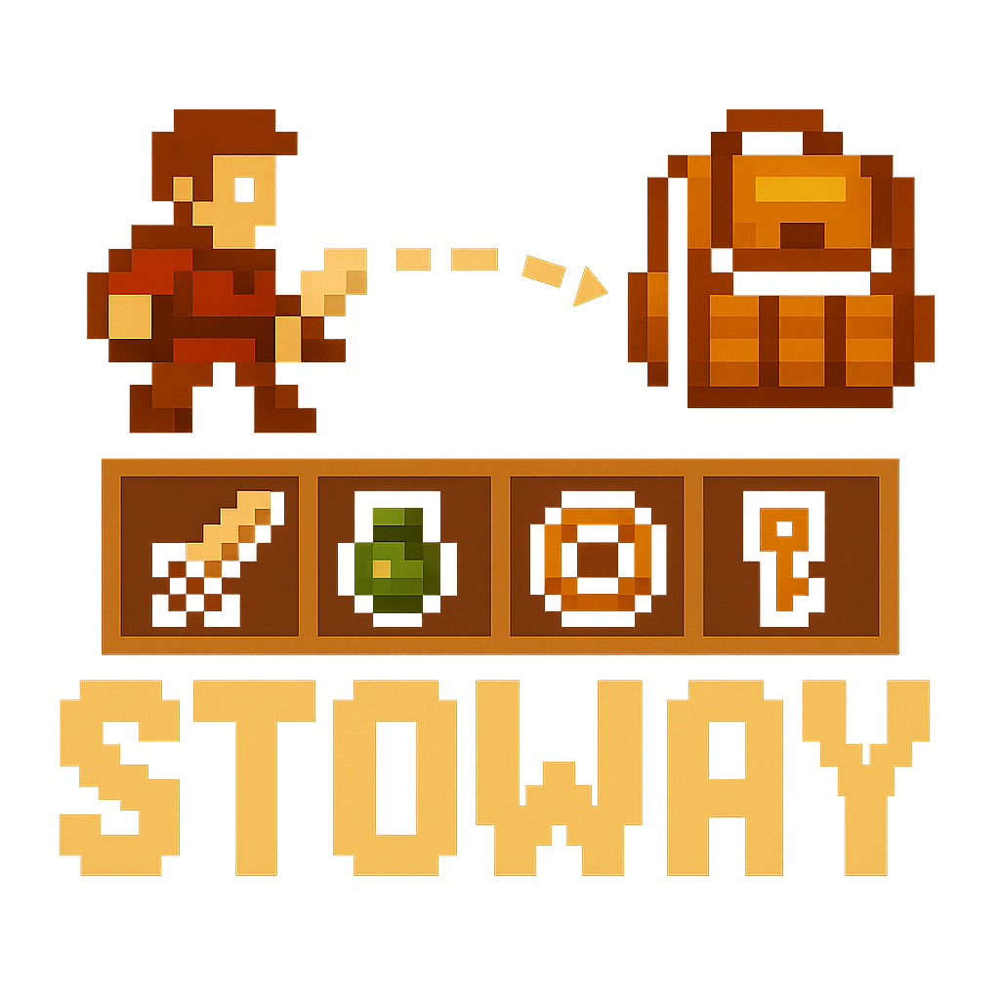
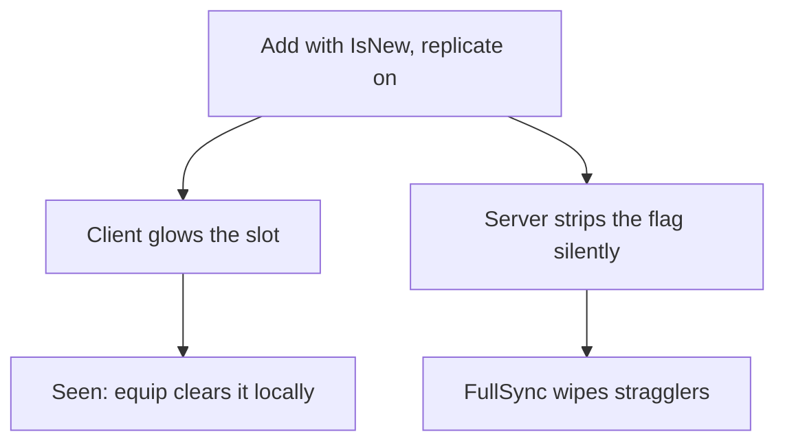

# Stoway - New-Item Glow


<div style="display:flex; flex-direction:column; gap:2px;">
<p><strong>Stoway</strong> 
is a full inventory system split into independent layers. Each layer is built in its own branch so it can be developed, tested, and maintained separately.

```
Stoway
├── master             ← integration branch
├── corestore          ← pure Luau inventory engine
├── server             ← orchestration, networking, world
└── client             ← UI rendering, drag-and-drop (this branch forks it)
```

The layers talk to each other in one direction:

```
Client Layer → Network Layer → CoreStore ← World Layer
```

*CoreStore owns the inventory truth. Everything else reads from it or writes to it through its public API.* <br>
Download the latest packaged release from <a href="https://github.com/Zyn-ic/Stoway/releases">Releases</a>.
</p>
</div>

<br>

## This Branch: New-Item Glow

`example/new-item-glow` is ABOUT FIRST-SEEN GLOW — new items shine until
seen, built on one metadata flag with zero engine changes. `IsNew` is
client-ephemera, never server truth: game code grants with the flag
(replicate on, the client glows), then the server strips it silently
(replicate off, so FullSync can never resurrect it). The `NewGlow` instance
exists only while the flag is present — created on demand, destroyed on
clear. Equipping clears it locally, never sent back.



Try it in Studio play (chat commands): `/addnew sword` — the new stack
glows, the server copy is already clean. Details in `AGENTS.md`
([showcase section](AGENTS.md#new-item-glow-showcase-this-branch)).

## Credits

1. [**HowToRoblox**](https://www.youtube.com/watch?v=kqa4u_9mSTQ&list=WL&index=6) - sourced core backpack/hotbar mechanics from earlier versions.
2. [**Knineteen19**](https://www.youtube.com/watch?v=d2tdaRmqGXI&list=WL&index=8) - series on inventory/hotbar, persistence, and stacking.
3. [**Avafe**](https://devforum.roblox.com/t/neohotbar-a-modern-customizable-backpack/2738850) - learned about Fusion and reactive UI patterns.
4. [**Illusion**](https://devforum.roblox.com/t/illusions-inputactionsystem-currently-the-best-input-manager/4071242) - InputActionSystem module.
5. [**breadboardengineer1234**](https://github.com/breadboardengineer1234/QuickNet) - QuickNet, the drop-in networking library behind Stoway's client/server wire.
