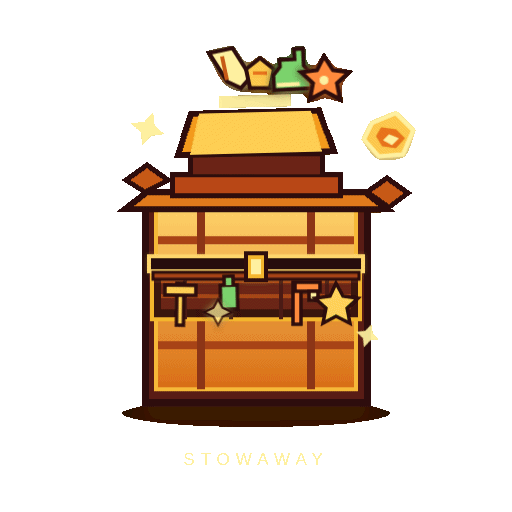
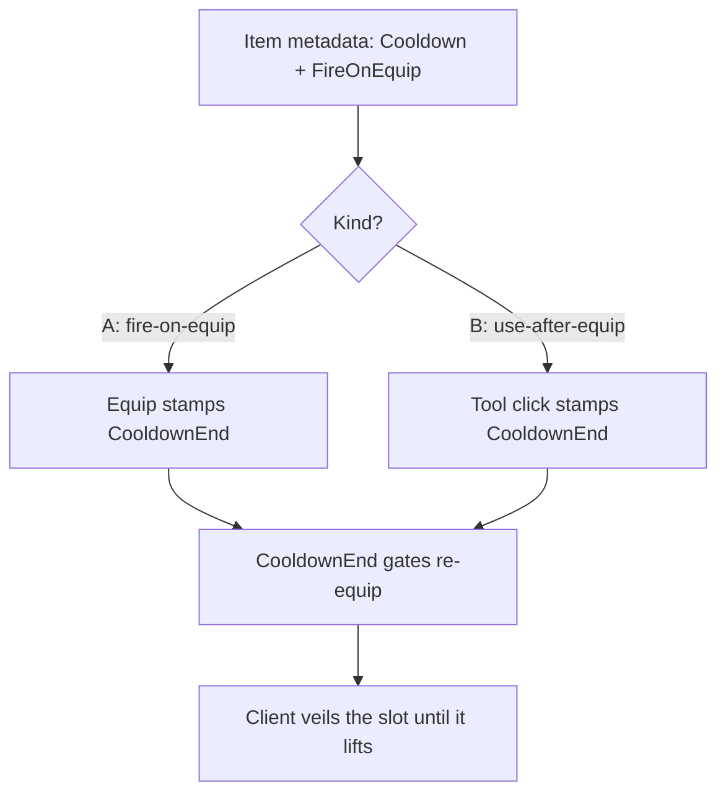

# Stoway - Cooldown Metadata


<div style="display:flex; flex-direction:column; gap:2px;">
<p><strong>Stoway</strong> 
is a full inventory system split into independent layers. Each layer is built in its own branch so it can be developed, tested, and maintained separately.

```
Stoway
├── CoreStore          ← pure Luau inventory engine (this branch)
├── Network Layer      ← delta replication, anti-exploit locking
├── World Layer        ← Tool spawning, equipping, dropping
└── Client Layer       ← UI rendering, drag-and-drop, hotbar visuals
```

The layers talk to each other in one direction:

```
Client Layer → Network Layer → CoreStore ← World Layer
```

<i>CoreStore owns the inventory truth. Everything else reads from it or writes to it through its public API.</i> <br>
Download the latest packaged release from <a href="https://github.com/Zyn-ic/Stoway/releases">Releases</a>.
</p>
</div>

<br>

## This Branch: Cooldown Metadata

`example/cooldowns` is ABOUT THE COOLDOWN METADATA — skill cooldowns built
purely on item metadata, zero engine changes. Designers set `Cooldown`
(seconds) + `FireOnEquip` (kind); the server stamps `CooldownEnd` and gates
re-equips; the client veils cooling slots until it lifts.



Try it in Studio play: open Conch (Backquote), `cooldown-demo Pickaxe a 5`,
press the hotbar bind. Details in `AGENTS.md` ([showcase section](AGENTS.md#cooldown-metadata-showcase-this-branch)).

## Credits

1. [**HowToRoblox**](https://www.youtube.com/watch?v=kqa4u_9mSTQ&list=WL&index=6) - sourced core backpack/hotbar mechanics from earlier versions.
2. [**Knineteen19**](https://www.youtube.com/watch?v=d2tdaRmqGXI&list=WL&index=8) - series on inventory/hotbar, persistence, and stacking.
3. [**Avafe**](https://devforum.roblox.com/t/neohotbar-a-modern-customizable-backpack/2738850) - learned about Fusion and reactive UI patterns.
4. [**Illusion**](https://devforum.roblox.com/t/illusions-inputactionsystem-currently-the-best-input-manager/4071242) - InputActionSystem module.
5. [**breadboardengineer1234**](https://github.com/breadboardengineer1234/QuickNet) - QuickNet, the drop-in networking library behind Stoway's client/server wire.
