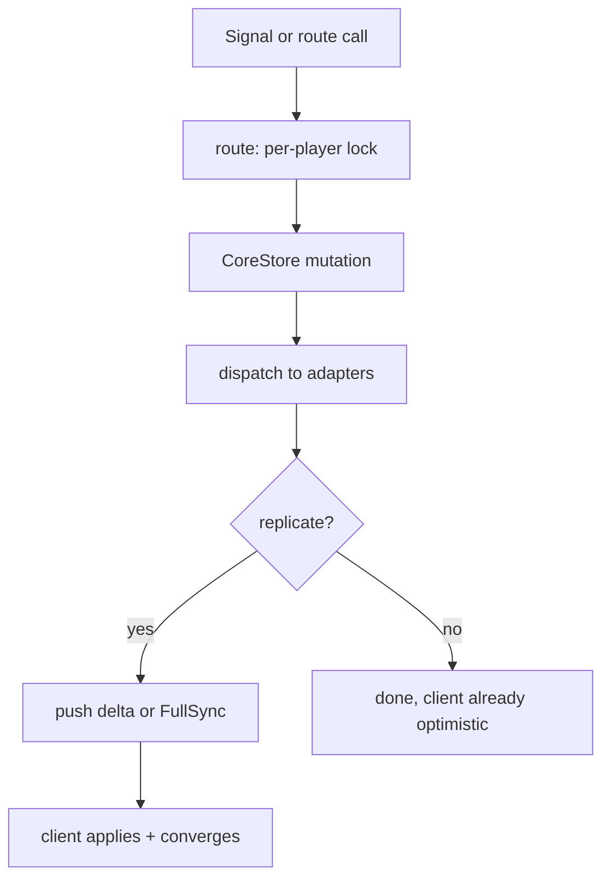

# Architecture

## Layers

| Layer | Branch | Lives at | Owns |
|-------|--------|----------|------|
| CoreStore | `corestore` / `client` | `ReplicatedStorage/Shared/Stoway/CoreStore/` | Items, slots, stacking, sorting, weight, metadata index |
| Server | `server` / `client` | `src/server/Services/StowayServerV3_0_0/` | Per-player states, 13 routes, replication, Tools |
| Client | `client` | `src/client/StowayClientV3/` | Snapshot boot, hotbar + storage UI, drag + drop, input |
| Shared | all | `ReplicatedStorage/Shared/Stoway/` | Types, settings defaults, colors, Result, wire schema |

Dependency direction: client → server → CoreStore. CoreStore never imports
upward — no Roblox types, no UI, no networking.

Disk maps to Roblox services via `default.project.json`: `ReplicatedStorage`
→ ReplicatedStorage, `src/server` → ServerScriptService,
`src/client` → StarterPlayerScripts. GUI prefabs and Tool templates live in
the `.rbxl` only (see [Skins & Layouts](skins-layouts.md)).

## InventoryState

```luau
{
  Items: { [uuid] = Item },            -- O(1): UUID → Item
  ItemsByID: { [id] = { uuid } },      -- O(1): ItemId → UUIDs
  Hotbar: { [slot] = uuid? },          -- 1..MaxHotbarSlots, Static has holes
  Storage: { uuid, ... },              -- packed array, no holes
  LocationByUUID: { [uuid] = SlotRef },-- O(1): UUID → where
  MetadataIndex: { field → value → { uuid } }, -- indexed: Rarity, Type
  EquippedItemUUID: uuid?,
  Weight: number,                      -- sum of Amounts
  Settings: Settings,
}
-- Item = { UUID, Id, Amount, Metadata }
```

## Operation lifecycle



- **Server:** every route runs under a per-player lock (3s timeout returns
  `OPERATION_IN_PROGRESS`). `replicate` is opt-in — omitted means no echo.
- **Client:** drags apply optimistically, then one `FireServer` per op. Server
  rejects arrive as revert + FullSync; reverts are log-only, never re-requested.
- **Settings:** designer defaults seed each state; changes push sparsely
  (`SettingsChanged`) with `FullSync` as backstop. The client overlays pushed
  settings onto its mirror state first, then fans out to atoms.

## Key settings

`HotbarType` (`Static` holes vs `Dynamic` packed), `MaxHotbarSlots` (10),
`Limit` (15, 0 = infinite), `CanStack`, `MaxStackSize` (5),
`BackpackEnabled`, `StackOnSwap`, `StackRequiredFields` (`Rarity`, `Type`),
`StackBlacklist` (Legendary/Mythic/Special), `Sorting`/`SortOrder`.

## Testing

Type checking gates everything (0 errors). Behavior is verified in Studio
playtests with observer-only probe scripts — a server `Script` or client
`LocalScript` that requires the live modules and prints verdict lines, then
gets deleted before committing. GUI is never trusted for functional
verification; probes peek store state directly.
