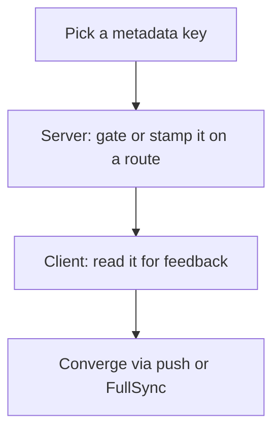

# Building on Top

Stoway is a **base system**. Features plug in at three seams without touching
the engine: a metadata key, a server gate or stamp, and a client read. Every
shipped example follows this recipe.

## The rules

1. **Server owns truth.** Only the server writes authoritative state. The
   client predicts for feel, then converges on pushes. React to results
   through [`registerAdapter`](adapters.md) — Communications is just one
   adapter.
2. **Metadata is the extension API.** New behavior = new keys on items, not
   new engine branches. Stacking identity, visual contracts, and showcase
   features all ride on metadata (see [Metadata](metadata.md)).
3. **Replicate deliberately.** `replicate` defaults off. Push deltas for
   single-item changes, FullSync when many things moved or a client must
   converge wholesale.
4. **Never write atoms directly.** Pushed state funnels through the mirror
   (`ApplyServer*`), then one `sync()` fans out. Direct atom writes get
   clobbered by the next op.

## The feature recipe

Worked example (cooldowns): designer sets `Cooldown` + `FireOnEquip`; the
`EquipSlot` route stamps `CooldownEnd` and refuses locked equips; the client
veils cooling slots from the same key; FullSync delivers stamps fired
elsewhere. Zero changes to `Operations`/`Slots`.

## The StowayPickup pattern

World drops are the template for server-owned glue: `Drop` tags a live Tool
(`Stoway` tag, touch stripped, 5 studs ahead); `StowayPickup.server.luau`
watches the tag, attaches a `ProximityPrompt`, and on trigger reads attributes
back into `AddToBackpack` — destroying the tool on success. One watcher, weak
keys, no per-tool scripts.

## Pitfalls that bite feature authors

- Writing Fusion atoms directly instead of the mirror state.
- Reading a live Instance property as a `Computed` fallback (self-perpetuating).
- `scope:ForPairs` with side effects but no `Observer` (lazy `For` never runs).
- Sync once per mutation; a second sync re-runs every dependent Computed.
- `{ Key = nil }` deletes nothing — use `CoreStore.METADATA_DELETE`.
- `Move` never stacks; `StackOnSwap` is swap-only. Design merges accordingly.
