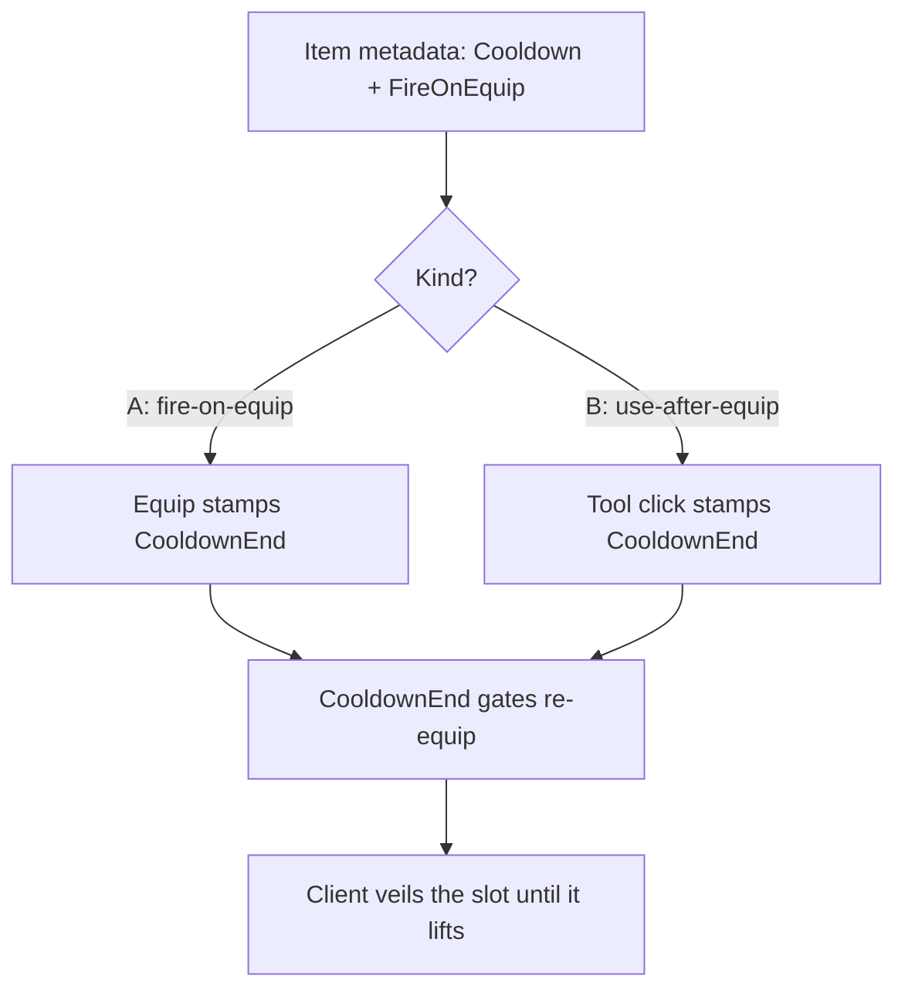

# Example: Cooldowns

`example/cooldowns` — skill cooldowns built purely on item metadata, zero
engine changes.

Designers set `Cooldown` (seconds) + `FireOnEquip` (kind); the server stamps
`CooldownEnd` and gates re-equips; the client veils cooling slots until it
lifts.

- **Kind-A** stamps inline on the `EquipSlot` route and auto-unequips; the
  client fires optimistically with expected-echo so the silent stamp never
  double-fires.
- **Kind-B** stamps on server-owned `Tool.Activated` connections, then unarms.
- Client writes to the three keys are stripped at the wire; stamps live in
  server-time so every machine reads the same epoch; `CooldownEnd` is a
  required stack field so cooling stacks can't be washed by merging.

Try it: `cooldown-demo Pickaxe a 5`, press the bind. Full write-up in the
branch's [`AGENTS.md`](https://github.com/Zyn-ic/Stoway/blob/example/cooldowns/AGENTS.md)
showcase section.
