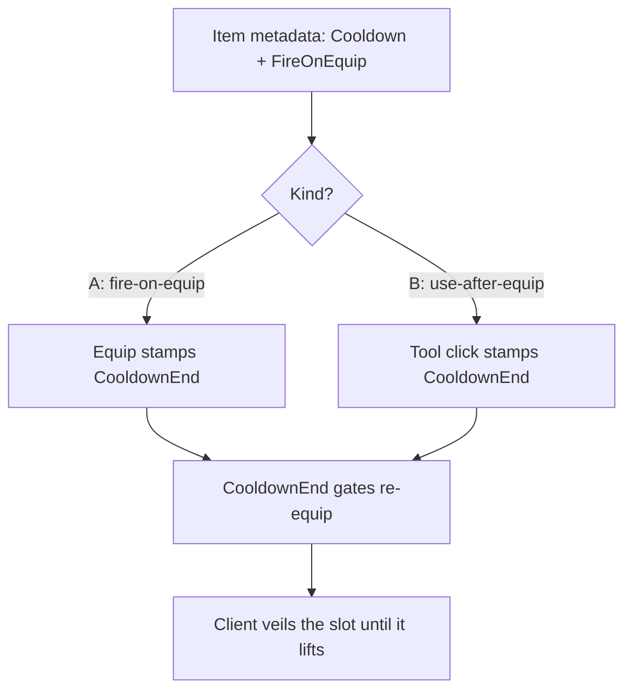

# Example: Cooldowns

`example/cooldowns` — skill cooldowns built purely on item metadata, zero
engine changes. [Browse the branch](https://github.com/Zyn-ic/Stoway/tree/example/cooldowns).

Designers set `Cooldown` (seconds) + `FireOnEquip` (kind); the server stamps
`CooldownEnd` and gates re-equips; the client veils cooling slots until it
lifts.

## How it works, step by step

**Grant.** `cooldown-demo Pickaxe a 5` adds the tool with
`{ Cooldown = 5, FireOnEquip = true }`. Plain metadata on a plain item —
the engine doesn't know or care.

**Kind-A fire.** Pressing the bind runs `equipAndClearNew`, which first asks
the gate: cooling + has duration → deny with a `CooldownDenied` flash, no
server call. Otherwise it equips, fires `fireSkill` (local veil starts,
`SkillFired` pops visuals, `_expectEcho` marks the UUID), then auto-unequips
— the cooldown, not the equip, is what blocks the next press. Meanwhile the
server's `EquipSlot` route stamps `CooldownEnd` inline and replicates, so
late joiners learn it from state.

**Kind-B fire.** Equipping arms a server-owned `Tool.Activated` connection
(`_activatedConns`, disconnected on equip/unequip/leave). A world click runs
`OnToolActivated`: wrong item, unarmed, or cooling → ignore; otherwise stamp
the end, replicate, unarm. Plain tools are never touched.

**Gates everywhere.** Server `EquipSlot` returns `ON_COOLDOWN` while locked.
Client binds and slot clicks on cooling UUIDs go silent-dead — the veil is
the feedback.

**The observer.** Stamps from elsewhere (another client, a rejoin) arrive via
`FullSync`. `observeCooldownEnds` diffs `CooldownEnd` against `_lastSeenEnd`:
own kind-A stamps (marked `_expectEcho`) record without refiring; fresh ones
anchor a local veil off **true remaining** — ends live in
`Workspace:GetServerTimeNow()`, one epoch for every machine, so rejoins
never over-veil.

**The launder.** `CooldownEnd` is a required stack field on this branch, so a
cooling stack can't be washed by merging into a fresh one (swap-absorb falls
back to positional). Both gates wipe expired ends via `METADATA_DELETE`, so
spent stacks restack. Client writes to all three keys are stripped at the
wire; only the server stamps.

## Why no engine changes

Cooldown is payload + external timing. `Operations` and `Slots` never see
it: stacking identity just compares one more field, gates live on routes,
veils read a local clock. The engine treats the keys as inert metadata.

## Try it

`cooldown-demo Pickaxe a 5`, press the bind. Watch the veil count down;
hammer the bind while cooling and feel the denies. Then `cooldown-demo sword
b 8`, equip, click in the world.

Key files: `Interactions/CooldownService.luau`, the observer + gates in
`Controller/ClientController.luau`, stamps + watchers in server `init.luau`,
the key policy in `Communications.luau`, `cooldown-demo` in
`Debug/ConchCommands.luau`.
