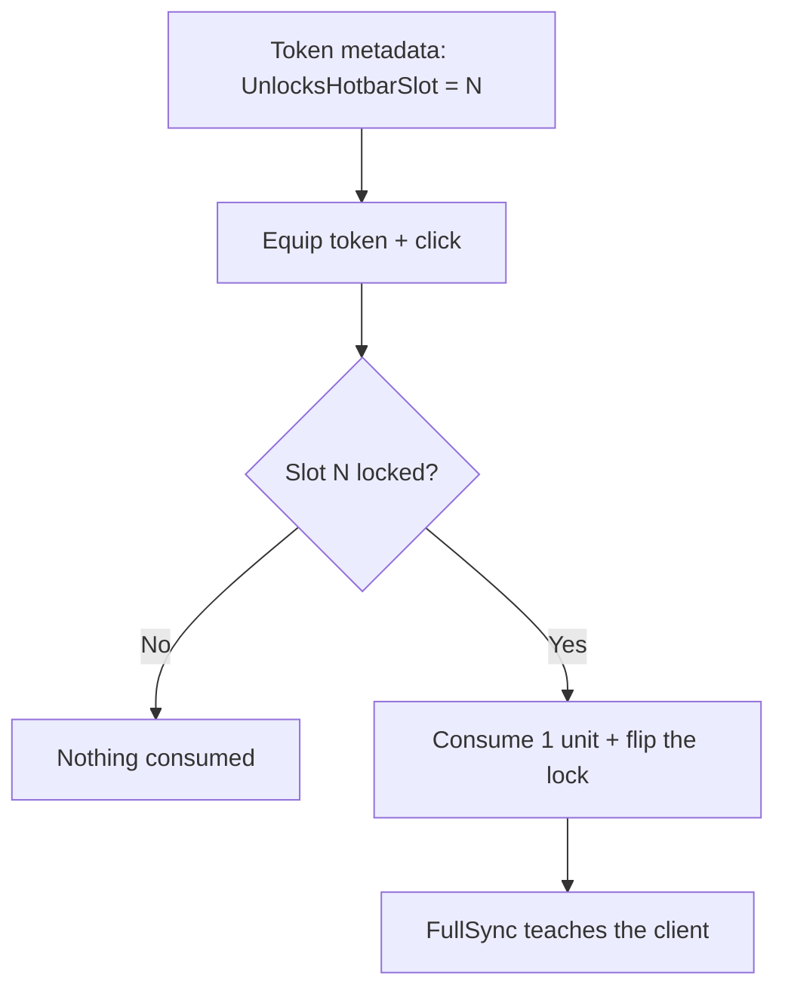

# Example: Locked Slots

`example/locked-slots` — metadata-keyed hotbar slot unlocks through USE, not
possession.

A token carries `UnlocksHotbarSlot = N`; equipping it and clicking consumes
one unit, flips slot N out of `Settings.LockedHotbarSlots`, and FullSync
teaches the client permanently. Merely holding the token unlocks nothing.

Locks live in Settings with a server placement guard and a client visibility
guard sharing one pure rule (`SlotLocks.isUnlocked`). Check-consume-flip is
atomic per tick, so double-clicks can't double-consume.

Try it (chat commands on this branch): `/addhot PouchToken`, equip, click →
slot 9 unlocks. `/locks` shows verdicts, `/relock` re-locks. Full write-up in
the branch's [`AGENTS.md`](https://github.com/Zyn-ic/Stoway/blob/example/locked-slots/AGENTS.md)
showcase section.
