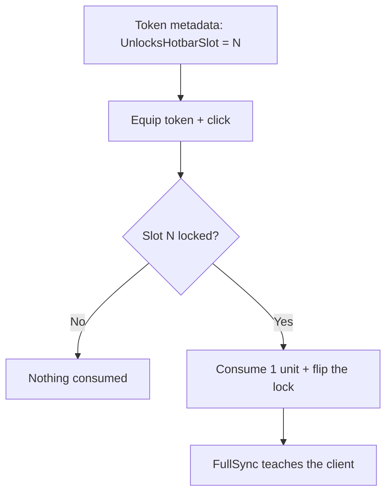

# Example: Locked Slots

`example/locked-slots` — metadata-keyed hotbar slot unlocks through USE, not
possession. [Browse the branch](https://github.com/Zyn-ic/Stoway/tree/example/locked-slots).

A token carries `UnlocksHotbarSlot = N`; equipping it and clicking consumes
one unit, flips slot N out of `Settings.LockedHotbarSlots`, and FullSync
teaches the client permanently. Merely holding the token unlocks nothing.

## How it works, step by step

**The rule.** `Shared/Stoway/SlotLocks.luau` is pure Luau both sides share:
`UNLOCK_FIELD = "UnlocksHotbarSlot"`, and `isUnlocked(locked, slot)` — a
slot binds unless it's in the locked set. Locks live in `Settings`
(default: slot 9), flipped server-side only. Nil set fails open.

**The token.** `UnlocksHotbarSlot` is authored as a Tool attribute (e.g. the
PouchToken template); `getDefaultMetadata` copies it into item metadata
untouched on every grant path, chat adds included.

**The use.** `src/server/SlotUnlockExample.server.luau` watches the
`UnlockToken` tag. Clicking an equipped token runs one atomic tick: find the
first inventory unit with a numeric `UnlocksHotbarSlot`, range-check it,
no-op if already unlocked (nothing consumed), else `RemoveItem` one unit,
flip the slot out of the locked set, `SendFullSync`. `route()` is
synchronous, so rapid double-clicks see the flipped settings and no-op
instead of double-consuming.

**The guards.** Server placement refuses locked slots; client
`Query.isHotbarSlotUnlocked` gates binds, clicks, and the keybind badge
(which captures the template color, never self-reads).

**The way back.** `/relock` re-locks slot 9, evacuating occupants to the
nearest free hotbar slot (`findNearestEmptyHotbarSlot`). `/locks` prints
per-slot verdicts, `/meta` prints token metadata.

## Why no engine changes

Locks are a settings set plus two guards. No slot mechanic moves: unlock
flips a boolean the engine already carries, and FullSync already teaches
settings. The engine never learns what a lock is.

## Try it

Chat commands on this branch: `/addhot PouchToken`, equip it, click → slot 9
unlocks. `/locks` to verify, `/relock` to lock it again.
