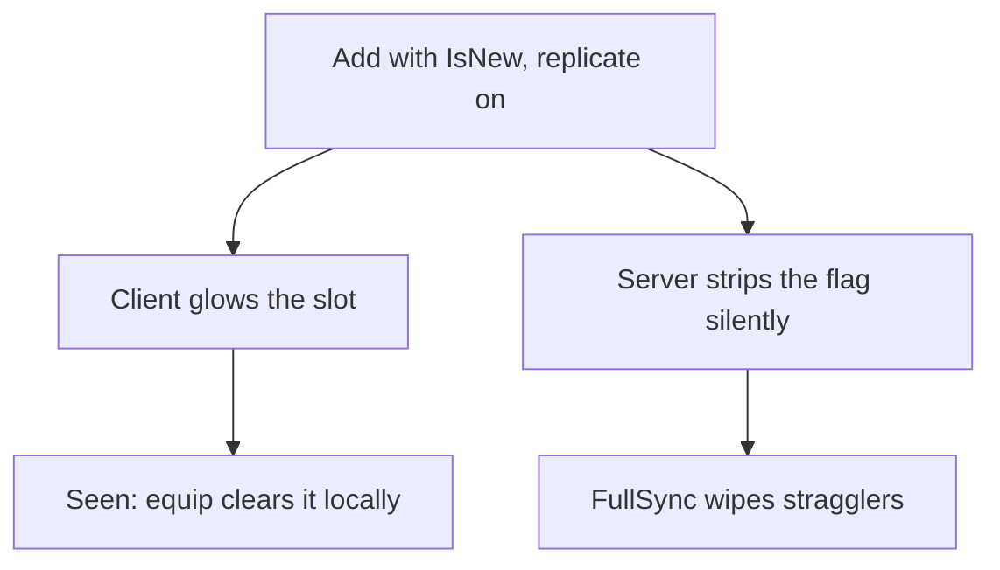

# Example: New-Item Glow

`example/new-item-glow` — first-seen shine on one metadata flag, zero engine
changes.

`IsNew` is client-ephemera, never server truth: grants replicate it on (the
client glows), the server strips it silently off (FullSync can never
resurrect it). The `NewGlow` instance exists only while the flag is present.
Equipping clears it locally, never sent back.

Try it (chat commands on this branch): `/addnew sword` — the new stack
glows while the server copy is already clean. Full write-up in the branch's
[`AGENTS.md`](https://github.com/Zyn-ic/Stoway/blob/example/new-item-glow/AGENTS.md)
showcase section.
