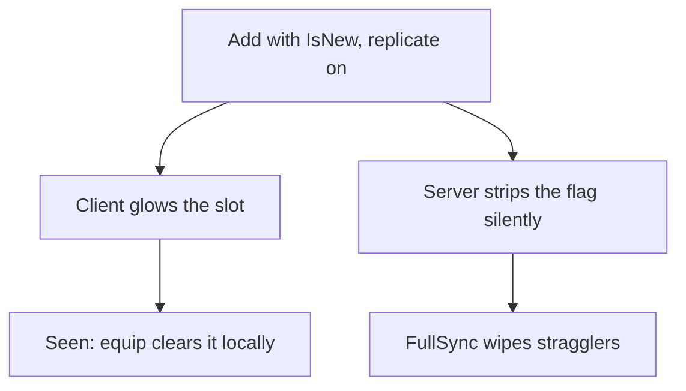

# Example: New-Item Glow

`example/new-item-glow` — first-seen shine on one metadata flag, zero engine
changes. [Browse the branch](https://github.com/Zyn-ic/Stoway/tree/example/new-item-glow).

`IsNew` is client-ephemera, never server truth: grants replicate it on (the
client glows), the server strips it silently off (FullSync can never
resurrect it). The `NewGlow` instance exists only while the flag is present.
Equipping clears it locally, never sent back.

## How it works, step by step

**Grant.** `/addnew sword` adds with `{ IsNew = true }`, replicate on. The
client renders the glow purely from metadata — on add, on sync, on metadata
update. No bus, no signal, just the flag.

**Strip.** Right after granting, the server deletes the flag with
`CoreStore.METADATA_DELETE`, replicate **off** — no echo, no event. Server
state stays clean, so a later FullSync carries no `IsNew` and cleared glows
stay cleared. Only brand-new stacks get the flag; pre-existing stacks keep
whatever they had.

**Seen.** Equipping clears the flag through a client-side `updateMetadata`
that is never sent back. Any FullSync wipes lingering glows anyway —
implicit mark-all-seen.

**Lifecycle.** The `NewGlow` instance is created on flag, destroyed on clear.
Slots without the flag carry no halo instances at all.

## Why no engine changes

Glow is a render-only read of one key. The engine already merges, indexes,
replicates, and deletes metadata — the feature is four calls composed in the
right order with the right replicate flags.

## Try it

Chat commands on this branch: `/addnew sword` — the new stack glows while
the server copy is already clean. Equip it and watch the glow die locally.
