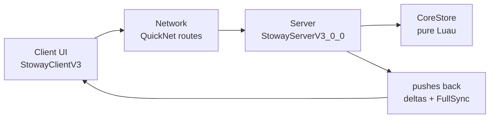

# Stoway

A Roblox inventory framework built in **layers**, one branch per layer. The core
is a pure-Luau inventory engine (`CoreStore`) — no Roblox types, no UI, no
networking — inside server orchestration, inside a Fusion client.



CoreStore owns the inventory truth. Everything else reads from it or writes
to it through its public API.

## Branches

| Branch | Holds |
|--------|-------|
| `master` | Integration branch |
| `corestore` | Pure Luau engine + Lune suites |
| `server` | Orchestration, networking, world |
| `client` | Playable skeleton: engine + server + Fusion UI (this site) |
| `example/*` | One idea each: `cooldowns`, `locked-slots`, `new-item-glow`. Forks of `client`, never merged |

## 30-second start

1. Open `stoway.rbxl` in Studio, run `rojo serve` from the repo root.
2. Press Play (solo).
3. Open the Conch console with Backquote and type `help`, then `inv`.

Type checking is the standing gate:

```
luau-lsp analyze --definitions="globalTypes.d.luau" --sourcemap="sourcemap.json" --ignore="**/Packages/**" src
```

Expected: **0 errors**. Live behavior is verified with in-game probe scripts
(see [Testing](architecture.md#testing) and the Testing Rules spec).

## Where to go next

- [Architecture](architecture.md) — layers, state shape, data flow
- [Building on Top](building-on-top.md) — the base-system philosophy + feature recipe
- [Metadata](metadata.md) — why metadata is the whole game
- [API Reference](api/corestore.md) — every CoreStore function, every route
