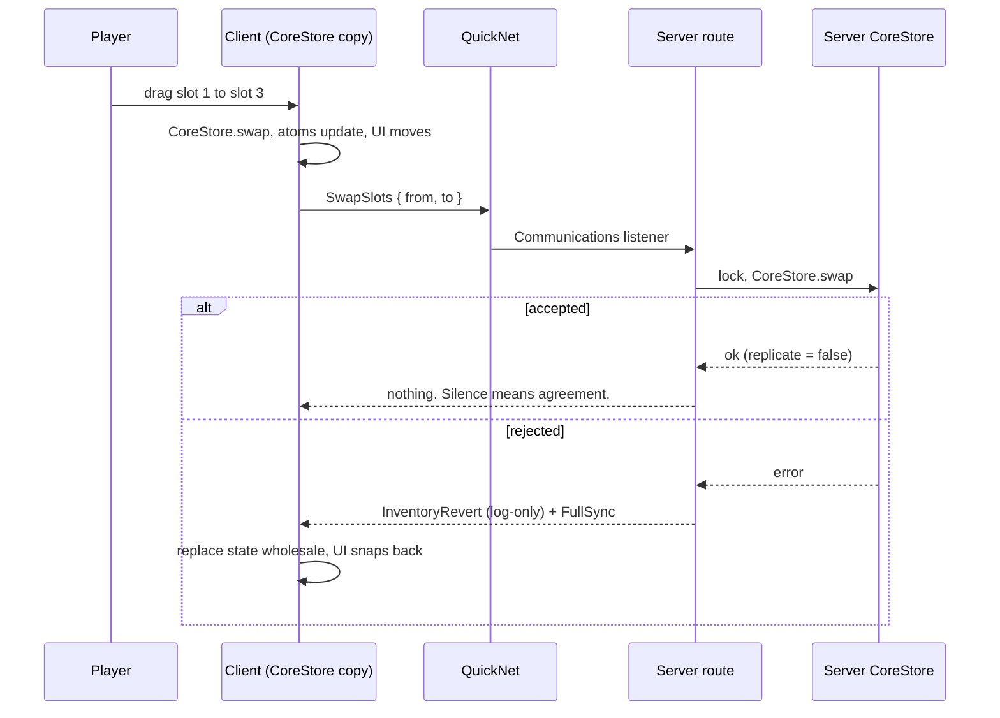

# Life of a swap

After this page you can trace any operation end to end, success and failure.

You drag the sword from slot 1 to slot 3. Here is everything that happens.

1. **Predict.** The client runs the swap on its own copy of CoreStore.
2. **Ask.** One `FireServer` per op.
3. **Decide.** The route takes a per-player lock, runs the real swap, and
   dispatches to adapters.
4. **Stay quiet or correct.** Client-originated ops do not echo on success.
   Failures correct through FullSync.

!!! note "Server-initiated changes are the opposite"
    Console commands and game code call routes with `replicate = true`, which
    pushes deltas (add, remove, equip) or a FullSync (swap, move, split,
    metadata, sort) so the client learns about changes it did not predict.

Next: [Building on top](building-on-top.md).
