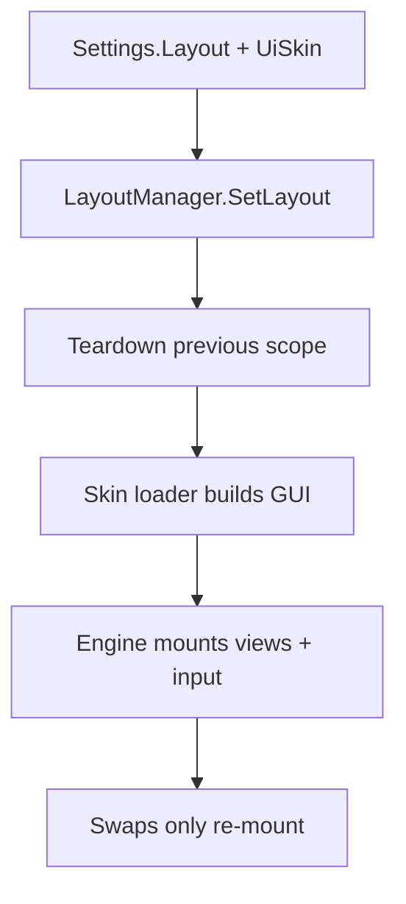

# Skins & Layouts

The client splits **behavior** from **look**: `HotbarType` picks a layout
engine, `UiSkin` picks a skin loader. `LayoutManager` mounts one against the
other, so new presentations land without touching state, controller, or
slots.

## Mount flow

`SetLayout` looks up the engine and loader (warns on unknown keys), tears
down the old scope, loads the skin prefab, and mounts. A server
`LayoutChanged` push re-mounts live.

## The engines

| Engine | Shape |
|--------|-------|
| `StandardHotbarStorage` | Static holes / Dynamic packed hotbar 1..Max, sectioned storage by `Type` with collapse + search + weight, full IAS input (PC/console/touch), ghost drag |
| `JailbreakHotbar` | Circular bottom hotbar + centered popup, sweep paint-to-move, swap-pop tween, lean binds |

Both call into **`Layouts/Shared`**: `getMaxSlots`, `isBackpackEnabled`,
`hasDestItem` (drives Swap-vs-Move), `handleSwap`/`handleMove` (warn-on-reject),
`doEquipSlot` (Dynamic visible→packed mapping, empty slot unequips),
`ensureDraggingGui` (adopt-or-create the drag ghost), and `bindResponsiveUi`
(code-built skins: popup above the hotbar, mobile toggle above the left slots).

## The skin contract

Prefab skins live in the `.rbxl` at `ReplicatedStorage/Stoway/GUI/<SkinName>/`
— flat, exactly one ScreenGui plus `Slot/`, never in the repo. The loader
clones it into PlayerGui and returns a handle: `Gui`, `HotbarFrame`,
`BackpackFrame`, `ScrollingFrame`, `WeightLabel`, `SearchFilter`,
`BackpackStuff`, slot `template` (`slotbutton`, `stackcount`, `slotnumber`,
`selecticon`, `rarityframe`), `DraggingGui`. Optional `Slot`-folder
attributes tune hiding (`GhostHidden` / `HideInStorage` / `HideInHotbar`,
comma-separated) and bleed (`SlotBleedPx`).

Three optional handle fields let a skin take over chrome the generic views
would otherwise own — all nil-safe, so prefab skins are unaffected:

| Field | Lets a skin |
|---|---|
| `HeaderColors` | Tint storage category headers per category key |
| `HeaderStyle` | Replace the whole header look (fill, transparency, text color/size, `FontFace`, corner, `UIStroke` color/thickness/line join, left/right padding) |
| `ResponsiveUi` | Opt into layout-owned popup + mobile toggle geometry (see below); `PopupTopOverhang` reserves skin art that hangs over the popup's top edge |

Two skins are **code-built** instead of prefabs — same handle shape, no
`.rbxl` asset, GUI built in Lua by the skin module:

| Skin | Layout | Notes |
|------|--------|-------|
| `Jailbreak` | `JailbreakHotbar` | Circular dark slots, no hooks table |
| `Persona` | `JailbreakHotbar` | Slanted ink cards + red shard, ships its own hooks table |

## The Persona skin

`Skins/Persona` is the slanted-ink skin: every card, tag and shard leans
-6 degrees, white miter outlines, ink fill, one red accent (`235,35,55`)
— the same language as the combo counter. The look lives in
`Persona/Theme.luau` (palette, font, tilt, card geometry), so a tweak
lands once.

It ships its own **hook table** (`Persona/Hooks.luau`), so the visuals
ride the skin hooks without a `HookFuncs` prefab folder: all eleven hooks
are wired to a punch in `Persona/Fx.luau` (elastic kick, white flash,
edge flicker, slash burst, shockwave ring, equipped-bar pulse).
`Persona/Fx.luau` is plain TweenService — no per-frame loop, no Fusion
objects per event — and every effect is parented to the skin's
full-screen `Fx` overlay so the storage grid can't clip it.

The drag marker belongs to the **destination**, not the source: the sweep
arms on the pressed card (`OnDragStart`), but `OnSlotHover` moves the hot
outline (`Fx:SetHot`) to the slot under the pointer, and `OnDragEnd` drops
it. Only one card is ever lit.

Switch it with `set-skin Persona` (it pairs itself with the
`JailbreakHotbar` layout).

## Responsive geometry

Prefab skins carry authored `Backpack` / `BackpackStuff` positions: the layout
leaves them alone. Code-built skins have no prefab to author, so they set
`SkinHandle.ResponsiveUi = true` and `Shared.bindResponsiveUi` owns the two
pieces that break on small screens:

- **Popup** — bottom-anchored, centered over the hotbar with a 12px gap. Its
  height is clamped to the space between the safe area's top and the hotbar
  (minus `PopupTopOverhang`), its width to the safe-area width. It can never
  cover a slot, in Static or Dynamic.
- **Mobile toggle** — sits above the **left** end of the hotbar (so it clears
  Roblox's jump button and the centered popup), 8px above the slots. Its size
  follows the live slot size (`0.8x`, clamped 32–44px) instead of a fixed
  48/44px, so the glyph scales with the bar.

Geometry is read from the live safe-area + hotbar rectangles, not camera math,
so rotation and device resize re-flow without a remount. The tracking tick is
deferred and coalesced: `AbsolutePosition`/`AbsoluteSize` also change *during*
a Fusion graph change (the hotbar resizing itself), and setting a `Value` from
inside a graph change trips Fusion's infinite-loop guard.

Both `Jailbreak` and `Persona` opt in. `StandardHotbarStorage` also skips its
own bottom-reserve `Size` binding for these skins, since the popup geometry is
already clamped.

## Authoring checklist

- **A new skin:** one ScreenGui + `Slot/template` with the named nodes, then a
  thin loader stamping look data. Missing nodes are nil-safe; views skip them.
- **A new code-built skin** (Jailbreak, Persona): a module that builds the
  GUI in Lua and returns the same handle — no prefab, no `.rbxl` asset.
- **A new layout:** one `Mount(scope, skin, store)` using `Shared` for commits
  and `SlotView.Create` per slot; register it in `LayoutManager`.
- **Slot chrome** (image, stack badge, rarity, team ring, keybind, equip) is
  shared in `SlotView` — layouts don't reimplement it.
