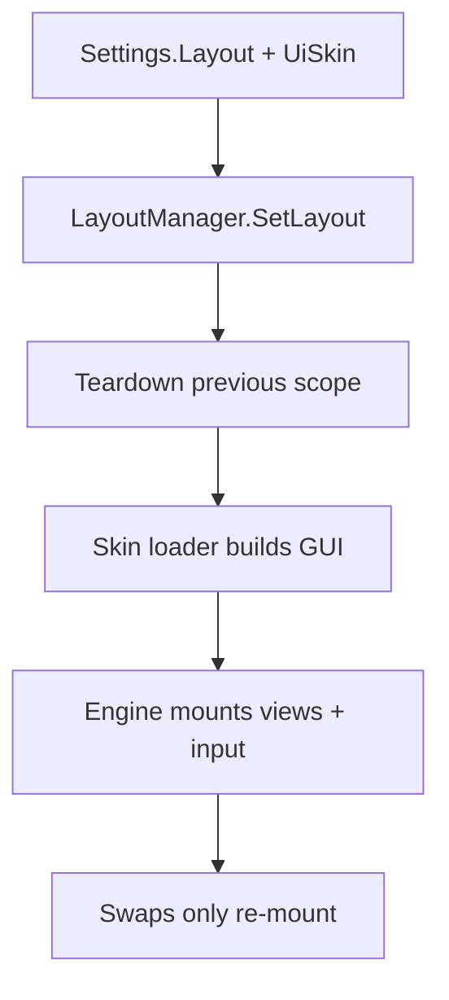

# Skins & Layouts

The client splits **behavior** from **look**: `HotbarType` picks a layout
engine, `UiSkin` picks a skin loader. `LayoutManager` mounts one against the
other, so new presentations land without touching state, controller, or
slots.

## Mount flow

`SetLayout` looks up the engine and loader (warns on unknown keys), tears
down the old scope, loads the skin prefab, and mounts. A server
`LayoutChanged` push re-mounts live.

## The engines

| Engine | Shape |
|--------|-------|
| `StandardHotbarStorage` | Static holes / Dynamic packed hotbar 1..Max, sectioned storage by `Type` with collapse + search + weight, full IAS input (PC/console/touch), ghost drag |
| `JailbreakHotbar` | Circular bottom hotbar + centered popup, sweep paint-to-move, swap-pop tween, lean binds |

Both call into **`Layouts/Shared`**: `getMaxSlots`, `isBackpackEnabled`,
`hasDestItem` (drives Swap-vs-Move), `handleSwap`/`handleMove` (warn-on-reject),
`doEquipSlot` (Dynamic visible→packed mapping, empty slot unequips),
`ensureDraggingGui` (adopt-or-create the drag ghost).

## The skin contract

Prefab skins live in the `.rbxl` at `ReplicatedStorage/Stoway/GUI/<SkinName>/`
— flat, exactly one ScreenGui plus `Slot/`, never in the repo. The loader
clones it into PlayerGui and returns a handle: `Gui`, `HotbarFrame`,
`BackpackFrame`, `ScrollingFrame`, `WeightLabel`, `SearchFilter`,
`BackpackStuff`, slot `template` (`slotbutton`, `stackcount`, `slotnumber`,
`selecticon`, `rarityframe`), `DraggingGui`. Optional `Slot`-folder
attributes tune hiding (`GhostHidden` / `HideInStorage` / `HideInHotbar`,
comma-separated) and bleed (`SlotBleedPx`). The Jailbreak skin is code-built
instead — same handle shape, no prefab.

## Authoring checklist

- **A new skin:** one ScreenGui + `Slot/template` with the named nodes, then a
  thin loader stamping look data. Missing nodes are nil-safe; views skip them.
- **A new layout:** one `Mount(scope, skin, store)` using `Shared` for commits
  and `SlotView.Create` per slot; register it in `LayoutManager`.
- **Slot chrome** (image, stack badge, rarity, team ring, keybind, equip) is
  shared in `SlotView` — layouts don't reimplement it.
